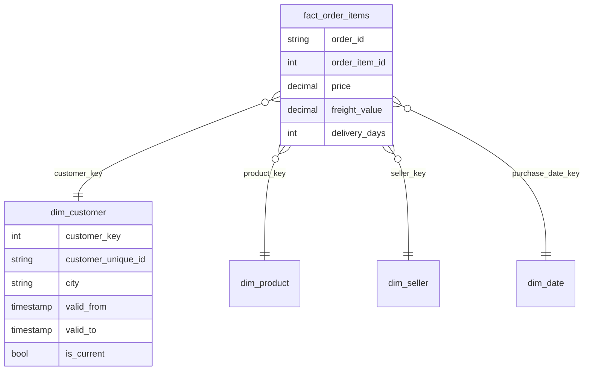

# Proyecto 2 · Modelado dimensional de un e-commerce

Parte de mi [ruta de ingeniería de datos](https://github.com/josemelguizo/ruta-datos).

 

> **Esto es un reto, no una solución.** La estructura, los datos de prueba y los tests están listos; el modelo lo escribes tú. Los tests empiezan en rojo y tu meta es ponerlos en verde.

## El reto

Olist es un marketplace brasileño. Te entregan 100.000 pedidos reales en varios CSV y el equipo de análisis te pide un *data warehouse* para responder preguntas como: ¿qué categorías venden más por estado?, ¿cuánto tardan las entregas?, ¿cambia el comportamiento de un cliente cuando se muda de ciudad?

Vas a construir un **esquema estrella** con DuckDB, incluida una dimensión de clientes que guarda el historial de direcciones (**SCD tipo 2**).

## Qué vas a practicar

- Modelado dimensional (Kimball): hechos, dimensiones y **grano**
- Llaves sustitutas frente a llaves naturales
- SCD tipo 2 y *joins* por vigencia (*point-in-time*)
- SQL con funciones de ventana: `ROW_NUMBER`, `LAG`, `LEAD`
- Carga incremental idempotente

## Modelo objetivo



## Preparación

1. Descarga el dataset de Kaggle: [Brazilian E-Commerce Public Dataset by Olist](https://www.kaggle.com/datasets/olistbr/brazilian-ecommerce) (necesitas una cuenta gratuita). Descomprime los CSV en `data/raw/`.
2. Instala:
   ```bash
   python -m venv .venv
   .venv\Scripts\activate          # Windows  (source .venv/bin/activate en macOS/Linux)
   pip install -e ".[dev]"
   ```
3. Corre los tests y mira cómo fallan: `pytest`

## Fases

Trabaja en orden. Cada archivo de `sql/` tiene instrucciones y pistas en los comentarios.

| Fase | Archivo | Tests que se ponen en verde |
|---|---|---|
| 0. Leer | `sql/01_staging.sql` (ya resuelto) | — |
| 1. Fechas | `sql/02_dim_date.sql` | `test_dim_date_*` |
| 2. Producto y vendedor | `sql/03_dim_product_seller.sql` | `test_dim_product_*`, llaves |
| 3. Cliente SCD2 | `sql/04_dim_customer.sql` | `test_scd2_*` |
| 4. Hechos | `sql/05_fact_order_items.sql` | `test_fact_*` |
| 5. Carga incremental | `src/modelo/scd2.py` | `test_merge_scd2_*` |

Corre solo un grupo de tests mientras trabajas: `pytest -k dim_date`

Los tests usan un mini Olist de 5 pedidos en `tests/fixtures/`. Ábrelo: como es pequeño, puedes calcular a mano la respuesta correcta y entender qué está pidiendo cada test.

Cuando todo esté en verde, construye el warehouse con los datos reales:

```bash
python -m modelo.build data/raw warehouse.duckdb
```

## Fase 6 · Responde con SQL

Crea `sql/consultas.sql` y responde, usando solo las tablas `dim_*` y `fact_*`:

1. Las 10 categorías con más ingresos, y su flete como % del precio.
2. Días promedio de entrega por estado del cliente. ¿Dónde tarda más?
3. Ventas por día de la semana: ¿se compra más en fin de semana?
4. ¿Cuántos clientes tienen más de una versión en `dim_customer`?
5. Para los clientes que se mudaron: ¿gastaron más antes o después? (aquí la SCD2 hace la diferencia)

## Criterios de terminado

- [ ] `pytest` en verde (también en la pestaña *Actions* de GitHub)
- [ ] El warehouse se construye con los datos reales
- [ ] `sql/consultas.sql` con las 5 respuestas
- [ ] Este README reescrito con: diagrama final, decisiones (¿por qué ese grano?, ¿por qué SCD2 y no sobrescribir?) y las respuestas a las preguntas que dejan los archivos SQL

## Para ir más allá

- Agrega `fact_payments` con grano de una fila por pago. ¿Por qué no cabe en `fact_order_items`?
- Agrega `dim_geolocation` con el CSV de geolocalización.
- Repite el modelo en PostgreSQL. ¿Qué cambia en el SQL?

## Recursos

- Ralph Kimball, *The Data Warehouse Toolkit*, capítulos 1 a 3 y 5 (SCD)
- [Documentación de DuckDB: funciones de ventana](https://duckdb.org/docs/sql/functions/window_functions)
